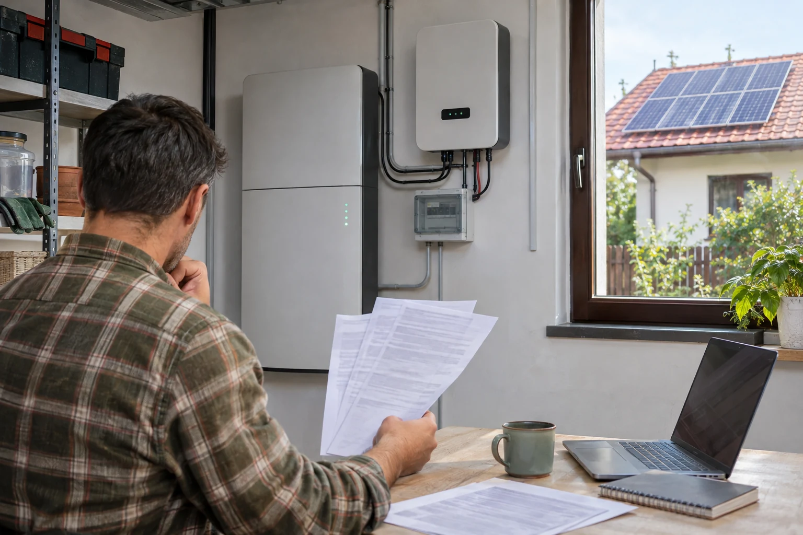

# Finanțarea bateriilor pentru prosumatori: plafoanele AFM nu sunt prețuri recomandate în Mehedinți

Pentru prosumatorii din Mehedinți, regulile comunicate la 18 noiembrie stabilesc modul în care va fi aleasă oferta. Programul pentru instalarea bateriilor la prosumatori are o alocare de 400 de milioane de lei, potrivit precizărilor transmise de Administrația Fondului pentru Mediu.

Persoana fizică va depune direct cererea, fără să aleagă în prealabil un instalator. După aprobarea dosarului, beneficiarul are 90 de zile pentru a compara și selecta una dintre firmele validate.

## Plafoanele nu sunt prețuri impuse

Cele două limite — cel mult 15.000 de lei și maximum 1.500 de lei pentru fiecare kWh — stabilesc eligibilitatea cheltuielilor, nu un tarif de piață recomandat.

Pentru o alegere informată, AFM recomandă oferte detaliate și comparații între instalatori; atingerea plafonului nu justifică automat costul cerut.

Eventualele practici anticoncurențiale sau comerciale înșelătoare intră în competența autorităților pentru concurență și protecția consumatorilor. Informațiile sunt prezentate aici într-o versiune editorială proprie pentru publicația emehedinti.

## Surse

- https://www.afm.ro/media_comunicate_presa-2026_11_18.php
