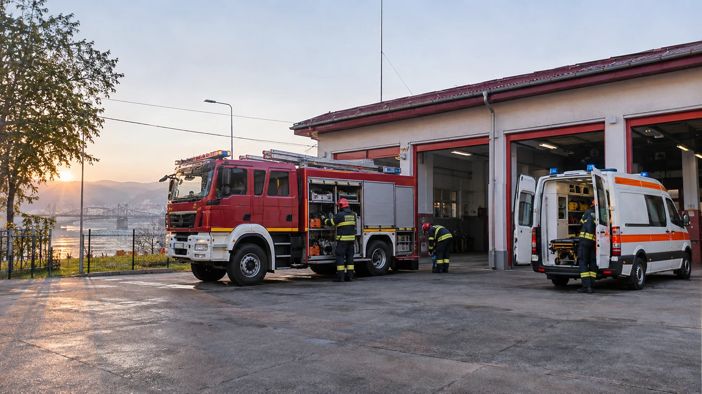

# Pompierii mehedințeni au gestionat 1.914 intervenții în două luni și jumătate — datele oficiale

Din total, 1.914 s-au înregistrat intervenții, aproximativ 26 pe zi. Echipajele au gestionat 1.073 de cazuri medicale, 95 de incendii și 456 de incendii de vegetație, alături de 37 de misiuni de sprijin, 73 pentru protecția comunităților și 134 de asistență ori salvare. ISU Mehedinți a prezentat bilanțul misiunilor din perioada 1 septembrie–15 noiembrie 2026: 1.957 de misiuni și acțiuni, cu 604 mai multe decât în intervalul similar al anului anterior.

Cele șase substații SMURD din județ au avut împreună 1.073 de misiuni, adică o medie de circa 14 pe zi. Bilanțul mai cuprinde 38 de recunoașteri și cinci exerciții. Informația privește direct comunitățile din Mehedinți.

## Surse

- https://isumh.igsu.ro/comunicate-de-presa/conferinta-de-presa-bilantul-misiunilor-desfasurate-de-pompierii-mehedinteni-757
