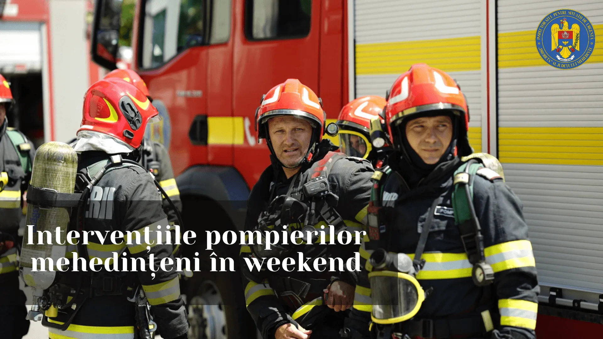

# Două incendii importante în Mehedinți: o hală și un apartament au fost afectate

Peste 90 de pompieri mehedințeni au fost zilnic la datorie în weekend, când au gestionat 39 de situații de urgență. Două incendii au produs pagube la Cujmir și Vânju Mare.

La Cujmir, flăcările au afectat aproximativ 100 m² dintr-o hală cu materiale de construcții și un autocamion. ISU Mehedinți indică drept cauză probabilă un scurtcircuit produs la un cablu sau conductor defect.

## Foc într-un bloc din Vânju Mare

În noaptea de sâmbătă, pompierii au intervenit la etajul al doilea al unui bloc de pe Aleea Garofiței. Au ars sufrageria și balconul pe circa 30 m², precum și aproximativ 20 m² din acoperiș.

În acest caz, cauza probabilă comunicată de salvatori a fost depozitarea cenușii și jarului nestins lângă materiale combustibile.

## Surse

- https://isumh.igsu.ro/comunicate-de-presa/misiuni-gestionate-de-pompierii-mehedinteni-739
