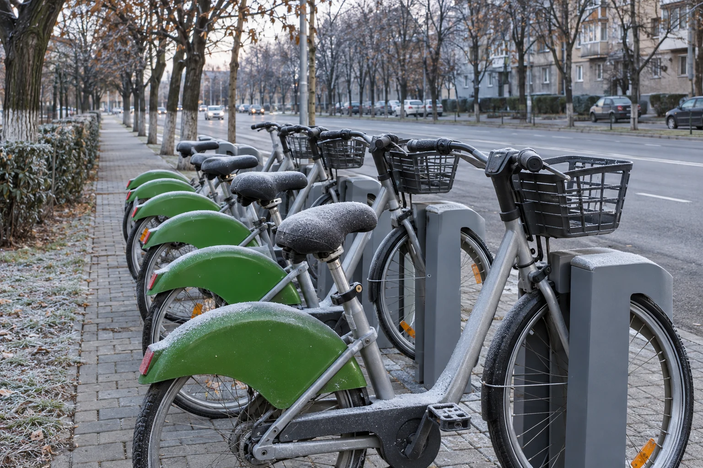

# Drobeta VeloCity intră în pauza de iarnă de la 1 decembrie

Sistemul de bike-sharing Drobeta VeloCity va fi suspendat temporar începând cu 1 decembrie 2026. Primăria explică măsura prin intrarea în sezonul rece și anunță că serviciul va reveni în primăvară.

## Datele comunicate de instituții

Administrația locală indică 4.925 de utilizatori activi în acest an, fără să publice în același anunț numărul total de curse sau durata medie a deplasărilor.

## Ce urmează

Utilizatorii trebuie să încheie cursele și să lase bicicletele în stații înainte de oprirea serviciului. Data exactă a reluării va fi comunicată ulterior de echipa VeloCity.

## Surse

- https://primariadrobeta.ro/2026/11/anunt-drobeta-velocity
