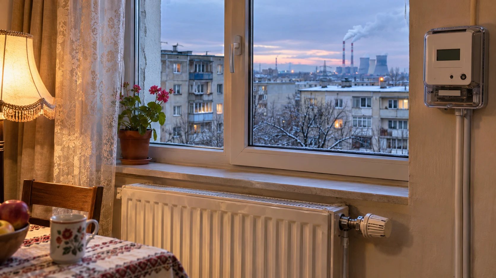

# Pregătirea energetică pentru iarnă: ce se știe despre vouchere și stocuri în Mehedinți

Pentru consumatorii din Mehedinți, noutatea imediată este organizarea pregătirii pentru iarnă, nu intrarea în vigoare a unui nou ajutor financiar.

Guvernul a constituit un grup de lucru pentru pregătirea sistemului energetic în sezonul rece, coordonat de Oleg Ungureanu și format din reprezentanți ai ministerelor, ANRE, producătorilor și industriei.

## Voucherele nu au încă valoare sau calendar

Executivul analizează carduri țintite pentru consumatorii vulnerabili, dar nu a adoptat încă suma sau calendarul. Detaliile depind de construcția bugetară și de identificarea fondurilor europene disponibile.

Datele ANRE invocate de Guvern indică peste zece milioane de locuri de consum, dintre care 4,7 milioane folosesc sub 100 kWh lunar. Pentru gospodării este analizată și o finanțare AFM de până la 400 de milioane de lei pentru sisteme de stocare, în limita bugetului aprobat.

## Măsuri pentru industrie și capacități energetice

Măsurile pentru marii consumatori pornesc de la programul de 150 de milioane de euro și pot fi completate cu garanții, contracte mai lungi și sprijin pentru producția ori stocarea realizată de companii.

Guvernul afirmă că depozitele de gaze sunt umplute în proporție de 85%. În aceeași prezentare, cele două unități de la Cernavodă sunt creditate cu aproape 20% din producție, iar conexiunea de la Negru Vodă este indicată drept rută suplimentară de alimentare.

Investițiile enumerate de Guvern sunt Mintia, aflată în testare la peste 1.700 MW, atingerea unui total de 2.000 MW de stocare până la sfârșitul anului și începerea testelor la Iernut, 430 MW, anul viitor. Realizarea lor trebuie verificată la termenele anunțate.

## Surse

- https://gov.ro/ro/stiri/declaratii-de-presa-sustinute-de-purtatorul-de-cuvant-al-guvernului-dan-carbunaru-pe-tema-energiei&page=1
