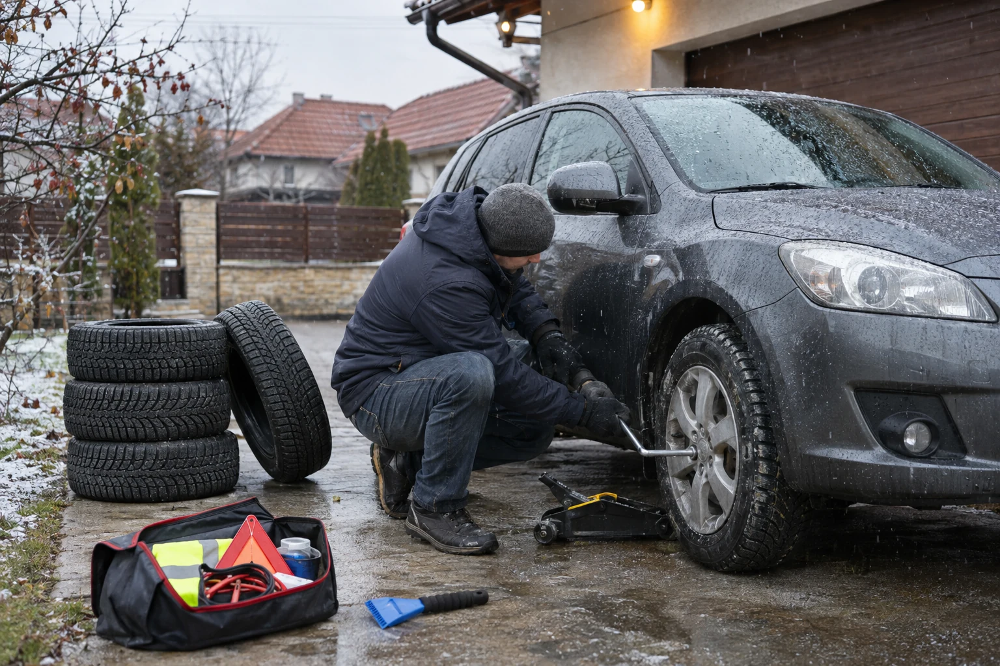

# Drobeta-Turnu Severin: ce trebuie verificat la mașină înainte de prima ninsoare. Ce arată informarea oficială

Campania națională IGSU despre circulația în sezonul rece le reamintește conducătorilor auto din Drobeta-Turnu Severin ce verificări trebuie făcute înaintea ninsorilor.

Verificările indicate privesc bateria, frânele, luminile și lichidul de parbriz potrivit temperaturilor scăzute.

## Datele publicate

În mașină ar trebui păstrate o lopată, o racletă, o lanternă și o pătură pentru situațiile în care deplasarea este întreruptă. Viteza trebuie redusă la starea carosabilului, iar distanța față de vehiculul din față mărită.

Pompierii recomandă montarea anvelopelor de iarnă înaintea apariției zăpezii și a poleiului.

## Surse

- https://isumh.igsu.ro/comunicate-de-presa/nu-astepta-prima-ninsoare!-preventia-nu-tine-de-vreme.-tine-de-tine.-751
