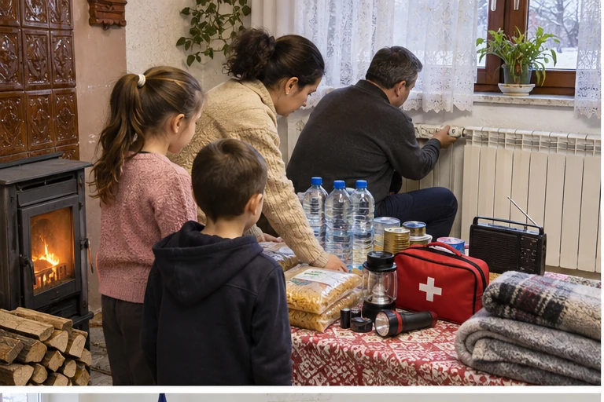

# Autoritățile din Mehedinți reamintesc măsurile esențiale pentru vremea de iarnă — datele oficiale

Pentru publicul din Mehedinți, datele oficiale relevante sunt următoarele. Șoferii trebuie să consulte starea drumurilor, să aibă echiparea de iarnă și să amâne deplasările când există avertizări severe.

Locuințele trebuie verificate înaintea gerului, în special coșurile de fum, sobele, centralele și instalațiile electrice.

Informațiile locale sunt transmise prin autoritățile județene și RO-Alert; numărul 112 trebuie folosit numai când există un pericol imediat.

## Surse

- https://igsu.ro/InformatiiUtile/SezonulRece
