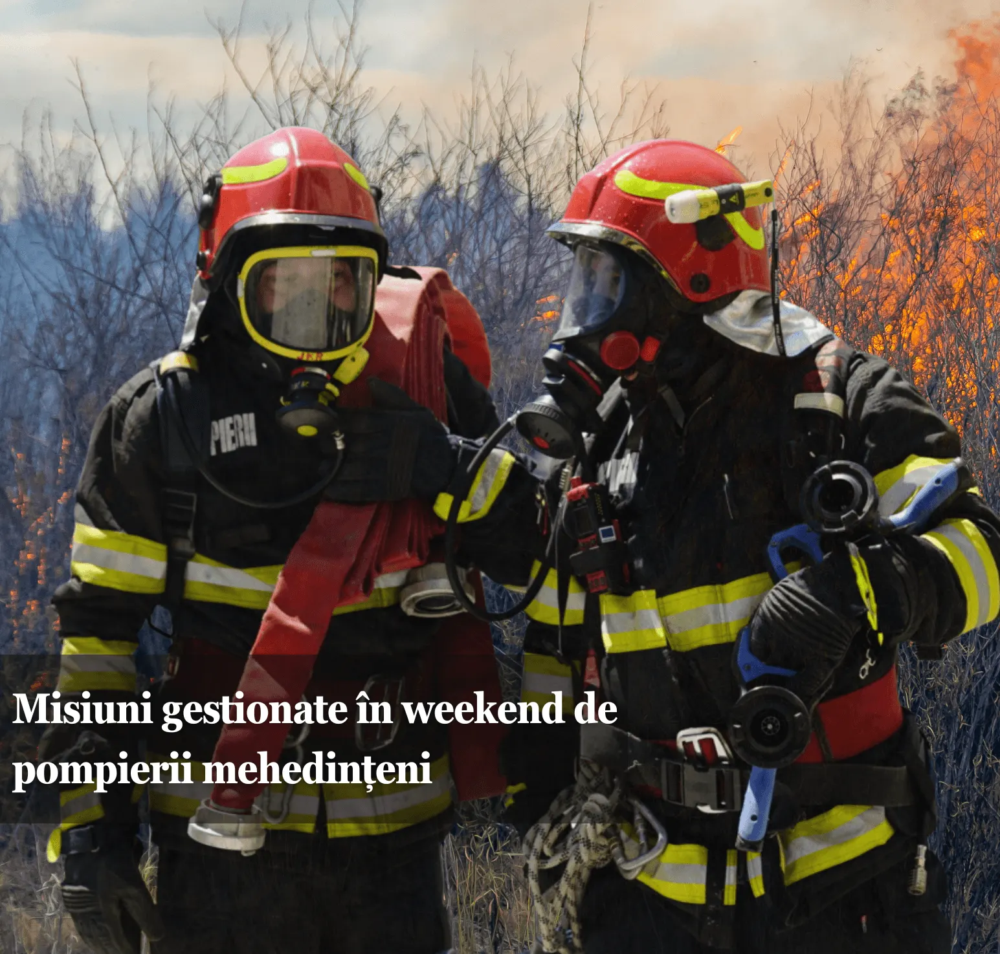

# Mehedinți: 39 de situații de urgență gestionate de pompierii mehedințeni în weekend

La Cujmir, un incendiu a afectat un depozit de aproximativ 100 de metri pătrați și un camion. Cauza probabilă indicată de pompieri a fost un scurtcircuit electric.

## Ce s-a întâmplat

Echipajele au intervenit și la un incendiu izbucnit într-un apartament din Vânju Mare, precum și la alte solicitări medicale și operative din județ.

## Informațiile autorităților

Peste 90 de pompieri mehedințeni au fost zilnic la datorie în weekend, iar echipajele au gestionat 39 de situații de urgență în județ.

## Ce urmează

ISU Mehedinți recomandă verificarea instalațiilor electrice și evitarea improvizațiilor care pot provoca incendii.

## Surse

- https://isumh.igsu.ro/comunicate-de-presa/misiuni-gestionate-de-pompierii-mehedinteni-739

