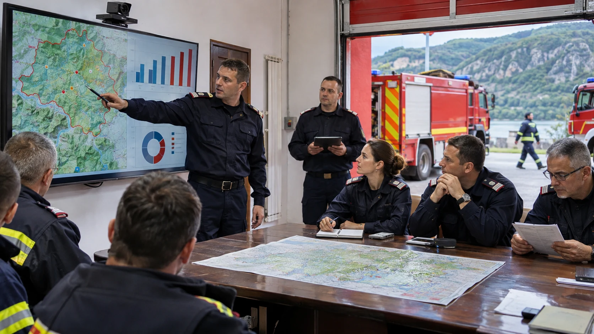

# Două persoane au murit în incendii de locuință în Mehedinți, în octombrie și noiembrie

Paramedicii celor șase substații SMURD au acordat ajutor medical pentru 1.078 de persoane: 1.032 de adulți și 46 de copii, cu aproximativ 14 solicitări pe zi.

## Informațiile oficiale

În lunile octombrie și noiembrie, două persoane au fost găsite decedate în locuințe cuprinse de flăcări. ISU precizează că doar două incendii de la începutul sezonului rece au pornit de la coșuri de fum.

Bilanțul ISU Mehedinți acoperă intervalul 1 septembrie–15 noiembrie 2026 și indică o creștere cu 604 de misiuni față de perioada similară a anului trecut.

## Surse

- https://isumh.igsu.ro/comunicate-de-presa/conferinta-de-presa-bilantul-misiunilor-desfasurate-de-pompierii-mehedinteni-757
