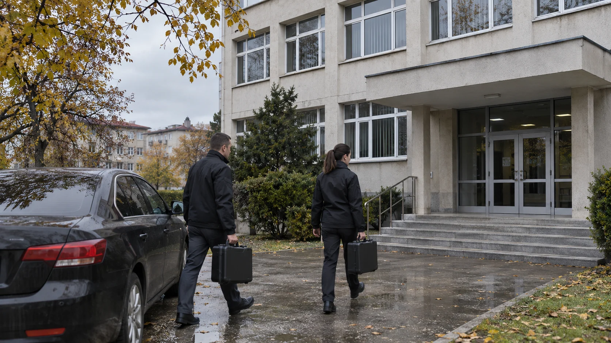

# Două persoane cercetate într-un dosar de trafic de droguri în Mehedinți

## Ce a anunțat instituția

Două persoane, de 20 și 40 de ani, sunt cercetate pentru trafic de droguri de risc.

În cauză au fost efectuate zece percheziții domiciliare la 9 noiembrie.

## Date utile pentru public

Acuzațiile sunt în curs de verificare, iar persoanele cercetate beneficiază de prezumția de nevinovăție.

Dosarul este instrumentat de SCCO Mehedinți și DIICOT – Biroul Teritorial Mehedinți.

## Surse

- [Sursa oficială](https://mh.politiaromana.ro/ro/stiri-si-media/comunicate/comunicat-de-presa-12-11-2026)

