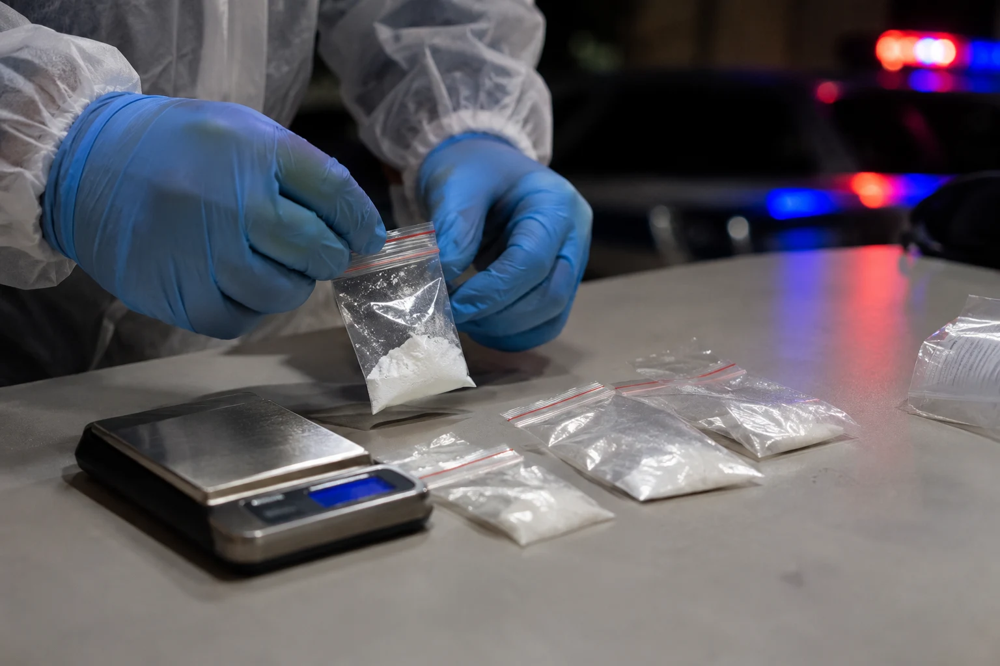

# Două persoane reținute într-un dosar de trafic de cocaină în Mehedinți

Procurorii DIICOT Mehedinți au reținut pe 25 noiembrie două persoane, de 18 și 30 de ani, cercetate pentru trafic de droguri de mare risc. Potrivit anchetatorilor, cei doi sunt membri ai aceleiași familii.

## Datele comunicate de instituții

DIICOT susține că, în cursul anului 2026, cocaina ar fi fost procurată, deținută, intermediată și vândută în municipiu la prețuri cuprinse între 400 și 800 de lei. În urma perchezițiilor au fost ridicate cocaină, cannabis, obiecte cu urme de substanță și un cântar.

## Ce urmează

La momentul comunicatului, procurorii propuneau Tribunalului Mehedinți arestarea preventivă pentru 30 de zile. Instanța urma să decidă, iar persoanele cercetate beneficiază de prezumția de nevinovăție.

## Surse

- https://www.diicot.ro/mass-media/6830-comunicat-de-presa-4-26-11-2026
