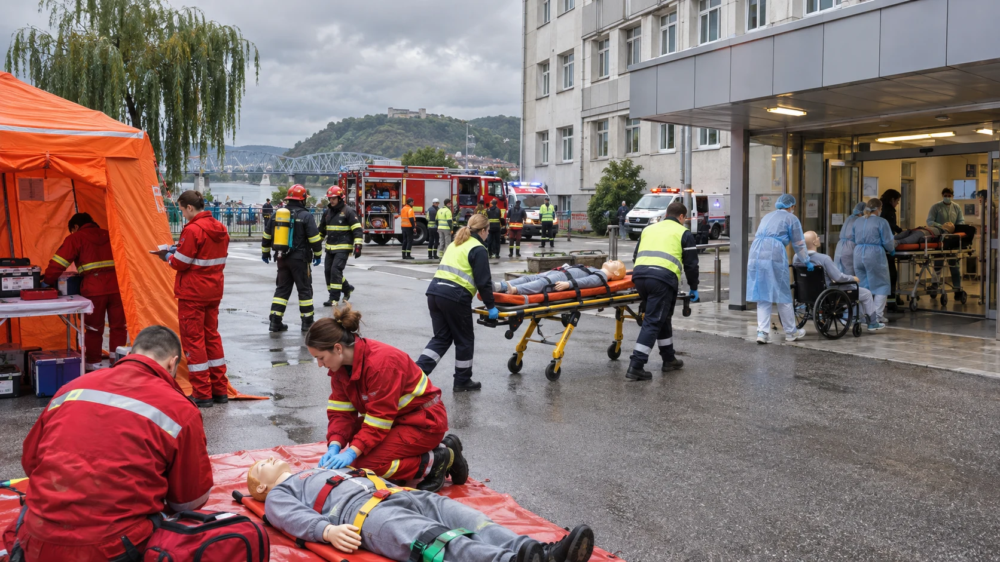

# Exercițiu interinstituțional la secția de boli infecțioase din Drobeta

Toate victimele, focarele și incendiul au făcut parte din scenariu; obiectivul a fost testarea coordonării în cazul unei epidemii suprapuse peste o urgență la spital. Acesta este efectul imediat al informării publicate de ISU Mehedinți.

## Detaliile anunțului

Într-un salon a fost simulat un incendiu produs de un scurtcircuit, cu un angajat și cinci pacienți afectați de fum sau arsuri. Forțele au exersat stingerea, căutarea, evacuarea, triajul, primul ajutor și gestionarea tensiunilor cu aparținătorii.

La exercițiu au participat ISU, polițiști, jandarmi, ambulanța, DSP și structurile spitalului. Scenariul a presupus o epidemie de gripă în mai multe județe, cu focare în școli, instituții și comunitate și presiune asupra spitalelor. A fost simulată convocarea Comitetului Județean pentru Situații de Urgență, declararea stării de alertă și activarea centrului județean de coordonare.

## Informația practică

Calendarul și statutul prezentate sunt cele comunicate de ISU Mehedinți; orice schimbare ulterioară trebuie verificată la sursa oficială.

## Surse

- https://isumh.igsu.ro/comunicate-de-presa/exercitiu-interinstitutional-organizat-de-isu-mehedinti-754
