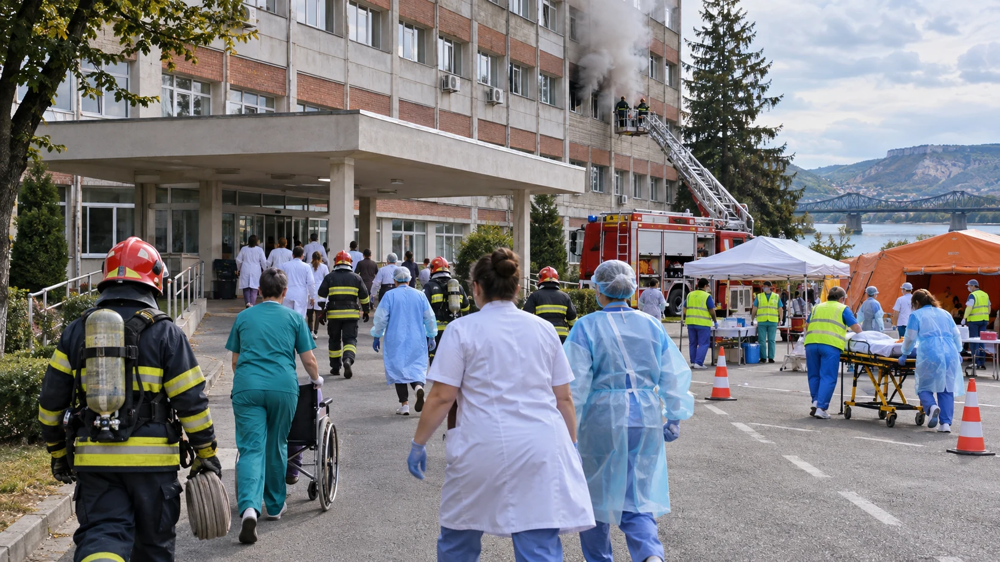

# Mehedinți: exercițiu interinstituțional organizat de ISU Mehedinți

Pentru cititorii din Mehedinți, informația verificată privește direct exercițiu interinstituțional organizat de isu mehedinți.

Au fost simulate activarea CJSU și CJCCI, aplicarea Planului Alb și un incendiu într-o cameră de spital. Scenariul a inclus un angajat cu arsuri și intoxicație și cinci pacienți expuși la fum.

ISU Mehedinți a organizat un exercițiu interinstituțional pornind de la scenariul unei epidemii de gripă, cu focare în școli, instituții și comunitate, presiune pe spitale și personal medical parțial indisponibil.

Participanții au exersat stingerea, salvarea, evacuarea, triajul și acordarea primului ajutor. Exercițiul a urmărit coordonarea instituțiilor, nu a descris o urgență reală.

## Surse

- https://isumh.igsu.ro/comunicate-de-presa/exercitiu-interinstitutional-organizat-de-isu-mehedinti-754
