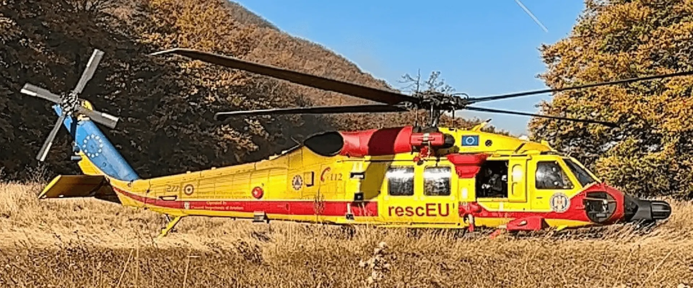

# Sufrageria și balconul unui apartament din Vânju Mare au ars din cauza jarului depozitat necorespunzător

Un incendiu izbucnit la etajul al doilea al unui bloc din Vânju Mare a distrus sufrageria și balconul unui apartament pe circa 30 de metri pătrați. Focul a afectat și aproximativ 20 de metri pătrați din acoperiș.

ISU Mehedinți arată că jarul și cenușa nestinsă au fost depozitate lângă materiale combustibile, aceasta fiind cauza probabilă a incendiului. Evenimentul s-a produs în cursul nopții de sâmbătă.

## Regula pentru cenușă

Resturile din sobă trebuie lăsate să se răcească complet și păstrate într-un recipient metalic, la distanță de casă și alte materiale care se pot aprinde. Inspectoratul recomandă și verificarea sobelor și coșurilor înainte de folosire.

## Surse

- https://isumh.igsu.ro/comunicate-de-presa/misiuni-gestionate-de-pompierii-mehedinteni-739
