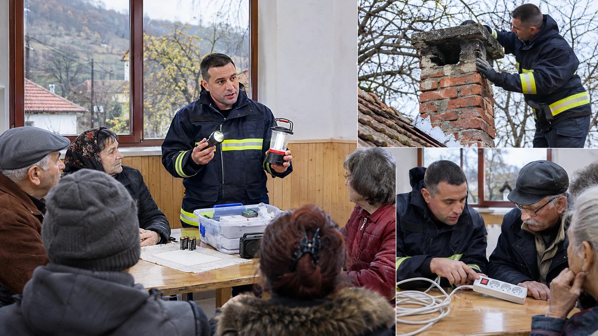

# Cum se pregătesc locuința și mașina pentru iarnă în Mehedinți

ISU Mehedinți le recomandă locuitorilor să nu amâne pregătirile pentru sezonul rece până la apariția zăpezii sau a înghețului.

O primă măsură este controlul sobelor, coșurilor de fum, centralelor și instalațiilor electrice. Echipamentele defecte sau improvizate nu trebuie folosite, iar reparațiile trebuie făcute de specialiști.

Instituția indică și verificarea acoperișului, a jgheaburilor și a ferestrelor. Obiectele care pot fi deplasate de vânt trebuie fixate, iar țevile de apă aflate la exterior trebuie protejate împotriva înghețului.

Pentru drumurile din sezonul rece, mașina trebuie verificată tehnic și echipată corespunzător. Prognoza și starea traseului trebuie consultate înainte de plecare, iar un kit de urgență poate fi util dacă deplasarea este întreruptă.

În locuință, o lanternă, baterii de rezervă și telefoane încărcate ajută în cazul unei pene de curent. Recomandările includ și sprijinirea vecinilor vârstnici, a copiilor și a altor persoane care pot avea nevoie de ajutor.

## Surse

- https://isumh.igsu.ro/comunicate-de-presa/nu-astepta-prima-ninsoare!-preventia-nu-tine-de-vreme.-tine-de-tine.-751
