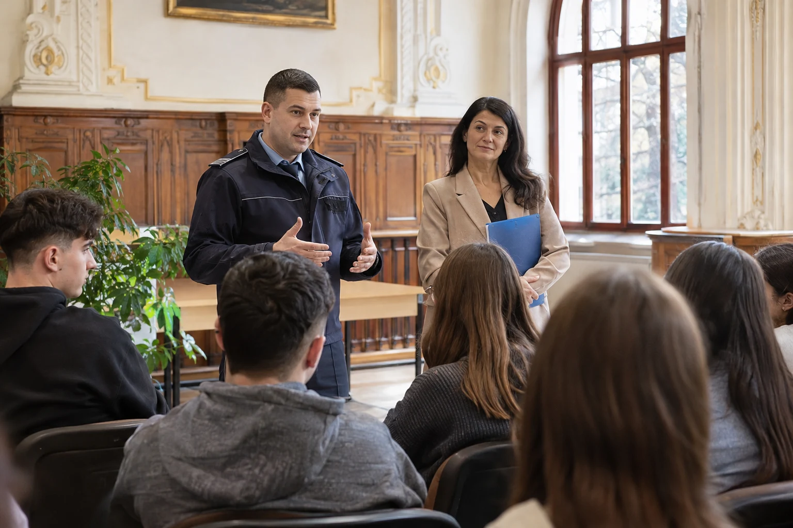

# Proiect nou la Colegiul Național Traian împotriva bullyingului și drogurilor

IPJ Mehedinți și Inspectoratul Școlar Județean au lansat pe 25 noiembrie proiectul „Nu-ți fie frică! Vorbește!”, la Colegiul Național Traian. Inițiativa este dedicată prevenirii violenței, bullyingului și consumului de droguri în rândul copiilor și tinerilor.

## Datele comunicate de instituții

Activitățile sunt concepute pentru ca elevii să recunoască situațiile de risc, să nu considere normale comportamentele abuzive și să ceară ajutor unui adult sau unei instituții competente.

## Ce urmează

Comunicatul de lansare nu include calendarul întâlnirilor viitoare, numărul școlilor participante sau bugetul proiectului. Aceste informații urmează să fie anunțate de instituțiile partenere.

## Surse

- https://mh.politiaromana.ro/ro/stiri-si-media/comunicate/comunicat-de-presa-25-11-2026
