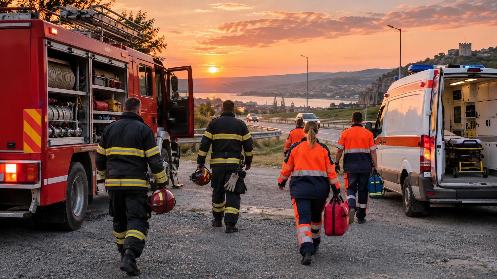

# Mehedinți: bilanțul misiunilor de weekend ale pompierilor din Mehedinți

La un accident cu două mașini pe centura Drobetei-Turnu Severin s-au înregistrat evaluate două victime conștiente, iar una s-a desfășurat transportată la UPU.

Echipajele de pompieri mehedințeni au gestionat 46 de situații de urgență în intervalul 13–15 noiembrie, inclusiv asistență medicală pentru 37 de persoane.

## Surse

- https://isumh.igsu.ro/comunicate-de-presa/weekend-in-siguranta-750
