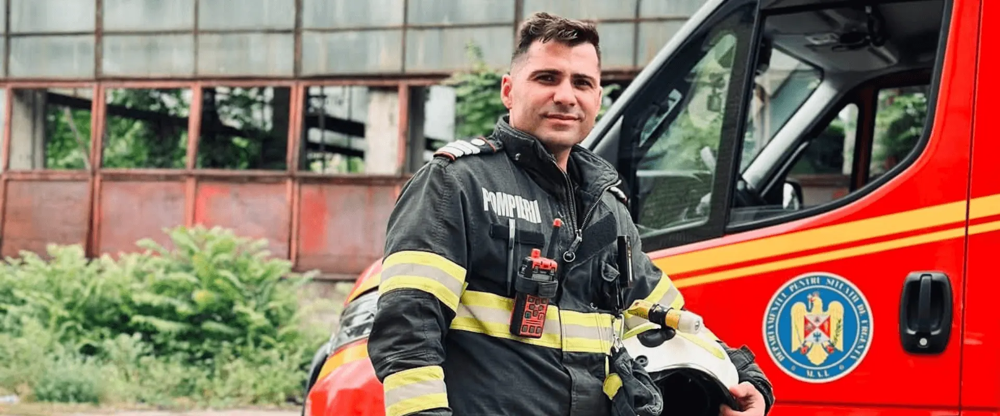

# Peste 200 de incendii stinse în țară în weekendul 6–8 noiembrie — datele pentru 6–8 noiembrie

*Imagine publicată de instituția care a emis informarea.*

Din informarea IGSU reiese că pompierii și echipajele de prim ajutor au gestionat peste 4.500 de situații de urgență de vineri până duminică, potrivit bilanțului publicat de Inspectoratul General pentru Situații de Urgență.

## Cum se conturează situația

Instituția consemnează că alte 570 de intervenții au vizat situații care puneau în pericol oameni, animale sau bunuri materiale.

Conform aceleiași surse, sobele, centralele și instalațiile de încălzire trebuie verificate, iar mijloacele improvizate sau defecte nu trebuie utilizate.

## Intervenția și consecințele practice

Separat, comunicatul arată că în același interval, salvatorii au intervenit la peste 200 de incendii produse în diferite zone ale țării.

Totodată, instituția atrage atenția că incendiile de locuință sunt mai frecvente în sezonul rece și recomandă curățarea coșurilor de fum înainte de folosire.

În același context, aproximativ 3.700 de persoane au primit asistență medicală de urgență, cele mai multe solicitări revenind echipajelor SMURD și celor de descarcerare.

## Surse

- [Sursa oficială](https://www.igsu.ro/comunicate-de-presa/misiunile-salvatorilor-din-acest-weekend-4284)
